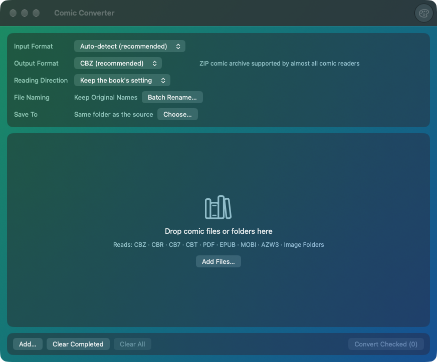

# Comic Converter for macOS

English | [简体中文](README.zh-CN.md)

A native macOS comic converter with a graphical interface and the `comicconv` command line. Convert between CBZ, CBR, CB7, CBT, PDF, EPUB, MOBI, AZW3, and image folders. Particularly useful for converting Kindle MOBI/AZW3 comics back to CBZ.



- Written entirely in Swift, with no third-party libraries. Build with Apple Command Line Tools; only AZW3 output requires [Calibre](https://calibre-ebook.com).
- **Lossless first**: JPEG/PNG pages are copied without recompression. JPEG pages are embedded directly in PDFs using DCTDecode and copied directly when read.
- **Correct page order**: MOBI/AZW3 follows image references in the text (`recindex` / `kindle:embed`), EPUB follows spine order, and archives and folders use Finder's natural sorting (`page2` before `page10`).
- **Reading direction**: Right-to-left manga settings are preserved between CBZ (ComicInfo.xml), EPUB, and MOBI.
- **Content-based format detection**: File headers determine the actual format, so incorrect extensions still work. You can also specify the input format manually and filter batch input to that format.
- **Batch naming**: Set a naming template before conversion (such as `One Piece Vol. {n}`) to write the new file names directly, with live previews in the list. Supports find/replace (including regex) and removal of bracketed tags such as 【汉化组】 (a scan-group label). Numbers follow list order, which you can change by dragging.
- **Checkboxes and multiple selection**: Each file has a checkbox; only checked items are converted. Hold ⌘ or ⇧ while clicking to select multiple items, then check, uncheck, or remove them together.
- **Background appearance**: The toolbar palette button offers 11 presets (Mint, Haze Blue, Sakura Pink, Cream, Morandi Gray, Lavender, Peach Gradient, Sunset Gradient, Aurora Gradient, Midnight Blue, Graphite), plus custom colors and images.
- **Safety**: Source files are never modified. A number is appended when an output name is taken, preserving existing files. Extraction blocks path traversal.

## Format support

| Format | Read | Write | Notes |
|---|:-:|:-:|---|
| CBZ / ZIP | ✅ | ✅ | Recommended. ZIP archive with ComicInfo.xml (title, author, page count, reading direction) |
| CBR / RAR | ✅ | ✅* | Reads RAR4/RAR5. *Writing requires RARLAB's `rar` command (`brew install --cask rar`), because RAR is proprietary |
| CB7 / 7Z | ✅ | ✅ | 7z archive: smallest size, but fewer readers support it |
| CBT / TAR | ✅ | ✅ | Uncompressed TAR archive; rarely used or needed |
| Image folder | ✅ | ✅ | Subfolders are treated as chapters and merged in natural order |
| PDF | ✅ | ✅ | Original images are extracted from scanned pages; text or vector pages are rendered at the chosen DPI (default: 300) |
| EPUB | ✅ | ✅ | Writes EPUB 3 fixed layout with Kindle comic metadata |
| MOBI / AZW / PRC | ✅ | ✅ | Writes MOBI 6; reads MOBI 6, KF8, combined MOBI 6 + KF8, and books created by Kindlegen/KCC |
| AZW3 | ✅ | ✅* | *Writing uses an installed copy of Calibre |
| KFX | — | — | Convert first with Calibre's KFX Input plugin |
| Any DRM-protected file | — | — | Detected and explicitly rejected |

Page images can be JPEG, PNG, GIF, WebP, HEIC, AVIF, BMP, TIFF, or JPEG 2000. Images unsupported by the target format are converted automatically: BMP/TIFF to PNG (lossless), others to JPEG (quality 92).

## Installation

Download the DMG from [Releases](https://github.com/boyeye/comic-converter-macos/releases) and drag “漫画格式转换.app” into Applications. Requires an Apple Silicon Mac and macOS 13 or later.

The app has no paid Developer ID signature or Apple notarization. If the first launch is blocked, try opening it once, then go to System Settings → Privacy & Security and click Open Anyway.

## Usage

**Graphical interface**: Drag files or folders into the window (or use Open With in Finder), choose an output format, and click Convert Checked. If a dropped folder contains comic files, they are all converted in a batch. If it contains only images, the folder is treated as one comic.

The interface language follows the macOS language settings (Chinese or English).

**Command line**: The app includes `comicconv`. You can create a link first:

```bash
sudo ln -sf "/Applications/漫画格式转换.app/Contents/MacOS/comicconv" /usr/local/bin/comicconv

comicconv -t cbz ~/Comics/mobi/                 # Convert comics in a folder and its subfolders to CBZ
comicconv -t epub --rtl -o ~/Desktop comic.cbz  # Write EPUB, force right-to-left, save to Desktop
comicconv -t pdf --dpi 200 scan.pdf             # Use 200 DPI when rendering non-image pages
comicconv -t cbz -f mobi ~/Downloads/           # Convert only MOBI/AZW3 files
comicconv -t cbz --name "{title} Vol. {n}" ~/Comics/  # Rename while converting
comicconv --inspect book.mobi                  # Print a content-free structural summary for bug reports
comicconv --help
```

Exit codes: 0 if all files convert successfully; 1 if any file fails; 2 for invalid arguments.

## Batch naming

Click Batch Rename… next to File Naming, or use `--name` on the command line.

| Token | Meaning |
|---|---|
| `{name}` | Source file name without extension, after find/replace and bracket removal |
| `{title}` / `{author}` | Title and author from book metadata (ComicInfo, EPUB, MOBI, PDF) |
| `{n}` | Numbered in the order of checked files; starting value and digit count are configurable (default: automatic, at least 2 digits) |
| `{pages}` / `{format}` / `{date}` | Page count, output format (such as CBZ), and conversion date |

The command line also supports the English aliases: `{name}` `{title}` `{author}` `{n}` `{pages}` `{format}` `{date}`.

`/` and `:` are replaced with full-width characters. Separators left at the start or end by empty tokens are trimmed. If the new name is taken, a number is appended without overwriting existing files.

```bash
comicconv -t cbz --name "One Piece Vol. {n}" --strip-brackets ~/Comics/OnePiece/
comicconv -t epub --regex --find ".*Vol.(\d+).*" --replace 'Vol.$1' ~/Comics/*.mobi
```

## When conversion fails

If a MOBI/AZW3 book fails to convert, run `comicconv --inspect filename` and include the output in an issue. This command prints only the file structure (record types and counts, header fields), without book content.

## Known limitations

- MOBI output preserves original images. Older Kindles may not display images larger than 127 KB; the tool warns when this occurs. For newer Kindles, use EPUB (via Send to Kindle) or AZW3.
- HD images for Kindle Store books are in a separate `.azw.res` file. This tool does not read it; it uses only the images embedded in the book.
- Text compressed with HUFF/CDIC cannot be parsed. In that case, MOBI images are arranged in image-record order and a warning is shown.
- PDF output page dimensions equal the image's pixel dimensions (1 pixel = 1 pt).
- PDF pages containing a single full-page image are extracted directly (the lossless path for scanned PDFs). Any visible text or vector graphics overlaid on such a page are not preserved; use a different source format in that case.
- To guard against malicious files, processing limits apply: archives may contain at most 100,000 files and expand to at most 20 GB. Declared sizes are checked before extraction, actual writes are monitored during extraction, and at least 1 GB of free disk space is always reserved (`COMICCONV_MAX_EXPAND_MB` can only lower the limit). MOBI files are limited to 700 MB and PDF rendering to 80 million pixels per page. All symlinks inside archives are deleted, and book files are read only after confirming that they are inside the extraction directory.
- The security model addresses malicious comic files, rather than malicious local programs running as you, which already have access to all your files. Pages extracted into a private temporary directory are therefore used directly by path without another copy.
- CBR output depends on a locally installed rar. Automated tests use a simulated rar to verify arguments and workflow only.

## Build and test

```bash
python3 build.py      # Build ComicConverter.app (GUI + comicconv), with ad-hoc signing
python3 test.py       # End-to-end tests; results go to Tests/results.json
python3 package.py    # Package dist/ComicConverter-<version>-arm64.dmg and verify it
```

Only Command Line Tools are required, not Xcode. SwiftUI's `@State` in the macOS 27 SDK depends on a macro plugin supplied only with Xcode, so `toolchain.py` automatically selects the latest installed macOS 26.x SDK when only Command Line Tools are available. You can also select an SDK with `COMICCONV_SDK`.

Tests generate 12 mixed-format pages (JPEG/PNG/HEIC/GIF/TIFF, including one landscape spread), convert them to each format and back to CBZ, then compare colors (to verify page order) and bytes (to verify lossless JPEG/PNG handling) page by page. With Calibre installed, additional checks include:

- Reading this tool's MOBI/EPUB/AZW3 output with Calibre.
- Generating MOBI 6, combined MOBI 6 + KF8, and AZW3 with Calibre as third-party input to test reading.
- Edge cases including DRM, KFX, path traversal, preserving existing output, and batch conversion.

Tests also simulate Kindlegen/KCC book structures (with a RESC record as the first resource), cover batch naming rules, and exercise the interface model without launching the UI: checkboxes, multiple selection, input-format filtering, naming previews and sorting, the conversion queue, and background presets.

Source layout: `Sources/Core` is the conversion engine shared by the GUI and CLI; `Sources/App` contains the SwiftUI interface and model; `Sources/CLI` is the command line; `Tests/Fixtures.swift` generates test pages; `Tests/ModelHarness.swift` tests the interface model; `Assets/` contains icons and their generation scripts.

## ☕ Buy me a coffee

This tool is free. If it helps you, you are welcome to [buy me a coffee](https://github.com/boyeye#-%E8%AF%B7%E6%88%91%E5%96%9D%E6%9D%AF%E5%92%96%E5%95%A1--buy-me-a-coffee) by scanning the WeChat code, with any amount you choose. Thank you for your support ❤️

If you find it useful, you can [buy me a coffee](https://github.com/boyeye#-%E8%AF%B7%E6%88%91%E5%96%9D%E6%9D%AF%E5%92%96%E5%95%A1--buy-me-a-coffee).

## License

MIT
