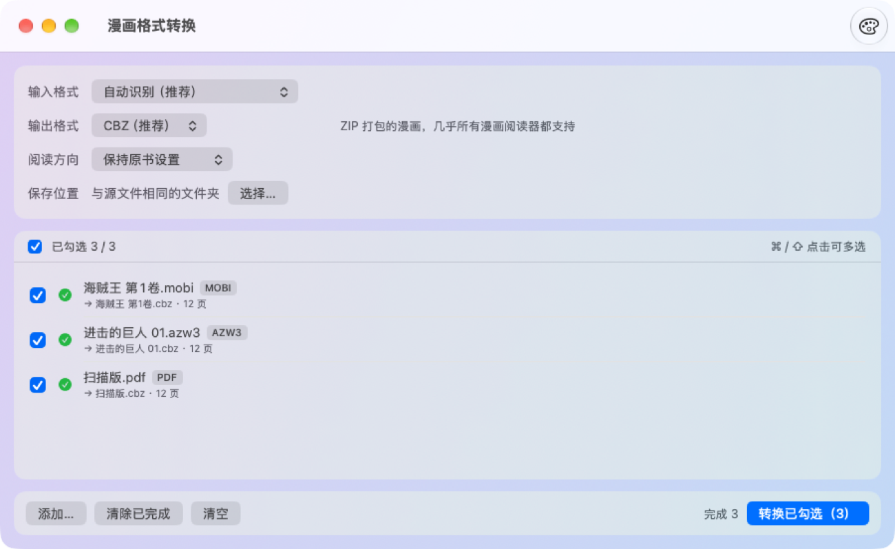

# 漫画格式转换 · Comic Converter for macOS

原生 macOS 漫画格式转换工具，提供图形界面和 `comicconv` 命令行。可以在 CBZ、CBR、CB7、CBT、PDF、EPUB、MOBI、AZW3 和图片文件夹之间互相转换，尤其适合把 Kindle 的 MOBI/AZW3 漫画转回 CBZ。



- 纯 Swift 编写，不依赖第三方库，只需 Apple Command Line Tools 即可构建；只有输出 AZW3 时需要 [Calibre](https://calibre-ebook.com)
- **无损优先**：JPEG/PNG 页面原样复制，不重新压缩。PDF 的 JPEG 页以 DCTDecode 直接嵌入，读出时也直接拷贝
- **页序准确**：MOBI/AZW3 按正文中图片引用的顺序（`recindex` / `kindle:embed`）排列，EPUB 按 spine 顺序排列，压缩包和文件夹按 Finder 的自然排序（`page2` 排在 `page10` 之前）
- **阅读方向**：日漫从右到左的设置可在 CBZ（ComicInfo.xml）、EPUB 和 MOBI 之间互相保留
- **按内容识别格式**：根据文件头判断真实格式，扩展名写错也能正确转换；也可以手动指定输入格式，批量处理时只挑出该格式的文件
- **批量命名**：转换前设置命名模板（如 `海贼王 第{序号}卷`），转换时直接写出新文件名，列表中实时预览每个文件的新名字。支持查找替换（可用正则）、去掉【汉化组】这类括号标记，序号按列表顺序编号，可以拖动调整顺序
- **勾选与多选**：每个文件都有复选框，只转换勾选的项目；按住 ⌘ 或 ⇧ 点击可多选，再批量勾选、取消勾选或移除
- **背景外观**：工具栏的调色板按钮提供 11 种预设配色（薄荷绿、雾霾蓝、樱花粉、奶油白、莫兰迪灰、薰衣草、蜜桃渐变、日落渐变、极光渐变、午夜蓝、石墨灰），也支持自定义颜色或图片
- **安全**：不修改源文件；遇到同名输出时自动加序号，不覆盖已有文件；解压时阻止路径穿越

## 格式支持

| 格式 | 读取 | 写出 | 说明 |
|---|:-:|:-:|---|
| CBZ / ZIP | ✅ | ✅ | 推荐。ZIP 打包，附带 ComicInfo.xml（标题、作者、页数、阅读方向） |
| CBR / RAR | ✅ | ✅* | 读取支持 RAR4/RAR5。*写出需要 RARLAB 的 `rar` 命令（`brew install --cask rar`），因为 RAR 是专有格式 |
| CB7 / 7Z | ✅ | ✅ | 7z 打包，体积最小，但支持它的阅读器较少 |
| CBT / TAR | ✅ | ✅ | TAR 打包、不压缩，很少使用，一般用不到 |
| 图片文件夹 | ✅ | ✅ | 子文件夹视为章节，按自然顺序合并 |
| PDF | ✅ | ✅ | 扫描版直接取出原图；文字或矢量页面按 DPI 渲染（默认 300） |
| EPUB | ✅ | ✅ | 写出 EPUB 3 固定版式，并带 Kindle 漫画元数据 |
| MOBI / AZW / PRC | ✅ | ✅ | 写出 MOBI 6；读取支持 MOBI 6、KF8、MOBI 6 + KF8 联合格式，以及 Kindlegen/KCC 生成的书 |
| AZW3 | ✅ | ✅* | *写出时调用已安装的 Calibre |
| KFX | — | — | 请先用 Calibre 的 KFX Input 插件转换 |
| 任何带 DRM 的文件 | — | — | 会识别并明确拒绝 |

页面图片支持 JPEG、PNG、GIF、WebP、HEIC、AVIF、BMP、TIFF 和 JPEG 2000。目标格式不支持的图片会自动转换：BMP/TIFF 转为 PNG（无损），其余转为 JPEG（质量 92）。

## 安装

在 [Releases](https://github.com/boyeye/comic-converter-macos/releases) 页面下载 DMG，把「漫画格式转换.app」拖进“应用程序”文件夹。需要 Apple Silicon Mac 和 macOS 13 或更新版本。

应用没有使用付费的 Developer ID 签名，也没有经过 Apple 公证。如果首次打开被拦截，先尝试打开一次，再到「系统设置 → 隐私与安全性」中点「仍要打开」。

## 使用

**图形界面**：把文件或文件夹拖进窗口（也可以在 Finder 中右键选择“打开方式”），然后选择输出格式，点击「开始转换」。如果拖入的文件夹中包含漫画文件，会批量转换其中所有文件；如果只包含图片，会把整个文件夹当作一本漫画。

**命令行**：应用内已附带 `comicconv`，可以先建立一个链接：

```bash
sudo ln -sf "/Applications/漫画格式转换.app/Contents/MacOS/comicconv" /usr/local/bin/comicconv

comicconv -t cbz ~/Comics/mobi/                 # 批量把文件夹（含子文件夹）中的漫画转成 CBZ
comicconv -t epub --rtl -o ~/Desktop 某漫画.cbz  # 输出 EPUB，强制从右到左，保存到桌面
comicconv -t pdf --dpi 200 扫描本.pdf            # 重新渲染非图片页时使用 200 DPI
comicconv -t cbz -f mobi ~/Downloads/            # 只转换其中的 MOBI/AZW3
comicconv -t cbz --name "{标题} 第{序号}卷" ~/Comics/  # 转换的同时批量命名
comicconv --inspect 某本书.mobi                  # 打印书的结构摘要（不含内容），方便反馈问题
comicconv --help
```

所有文件都转换成功时退出码为 0；有文件失败时为 1；参数错误时为 2。

## 批量命名

点「文件命名」右侧的「批量命名…」，或在命令行使用 `--name`。

| 变量 | 含义 |
|---|---|
| `{原名}` | 源文件名（不含扩展名），已应用查找替换和去括号 |
| `{标题}` / `{作者}` | 书内元数据中的标题、作者（ComicInfo、EPUB、MOBI、PDF） |
| `{序号}` | 按列表中已勾选文件的顺序编号；可设置起始值和位数（默认自动，至少 2 位） |
| `{页数}` / `{格式}` / `{日期}` | 页数、输出格式（如 CBZ）、转换日期 |

命令行也可以使用英文别名：`{name}` `{title}` `{author}` `{n}` `{pages}` `{format}` `{date}`。

`/` 和 `:` 会替换成全角字符；变量为空时，残留在首尾的分隔符会被清理掉；新名称与已有文件重名时自动加序号，不覆盖。

```bash
comicconv -t cbz --name "海贼王 第{序号}卷" --strip-brackets ~/Comics/海贼王/
comicconv -t epub --regex --find ".*第(\d+)卷.*" --replace 'Vol.$1' ~/Comics/*.mobi
```

## 转换失败怎么办

如果某本 MOBI/AZW3 转换失败，请运行 `comicconv --inspect 文件名` 并附上输出提交 issue。这条命令只打印文件结构（记录类型和数量、头部字段），不包含书的内容。

## 已知限制

- 写出 MOBI 时保留原图。旧款 Kindle 可能无法显示超过 127 KB 的图片，出现这种情况时工具会给出提示。新款 Kindle 建议使用 EPUB（通过 Send to Kindle 发送）或 AZW3。
- Kindle 商店的 HD 图片存放在单独的 `.azw.res` 文件中，本工具不读取，只使用书内自带的图片。
- 正文采用 HUFF/CDIC 压缩的 MOBI 无法解析正文，此时会按图片记录的顺序排列页面，并给出提示。
- 写出 PDF 时，页面尺寸等于图片的像素尺寸（1 像素 = 1 pt）。
- PDF 中“整页只有一张图片”的页面会直接取出原图（扫描版 PDF 的无损路径）。如果这样的页面上另外叠加了可见的文字或矢量图形，叠加部分不会保留；遇到这种情况请改用其他格式的源文件。
- 为防止恶意文件，有以下处理上限：压缩包最多 100,000 个文件、解开后最多 20 GB，解压前按声明大小检查，解压中按实际写入量监控，并始终保留至少 1 GB 磁盘空间（环境变量 `COMICCONV_MAX_EXPAND_MB` 只能调低这个上限）；MOBI 文件最大 700 MB；PDF 单页渲染最多 8000 万像素；包内的符号链接一律删除，书内文件只在确认位于解压目录内后才读取。
- 安全模型针对的是恶意的漫画文件，而不是本机上以你的身份运行的恶意程序：后者本来就能读取你的所有文件。因此压缩包内的页面解压到私有临时目录后直接按路径使用，不再额外复制。
- CBR 输出依赖本机安装的 rar；自动化测试只用模拟的 rar 验证了调用参数和流程。

## 构建与测试

```bash
python3 build.py      # 构建 ComicConverter.app（图形界面 + comicconv），使用 ad-hoc 签名
python3 test.py       # 端到端测试，结果写入 Tests/results.json
python3 package.py    # 打包成 dist/ComicConverter-<版本>-arm64.dmg 并验证
```

只需要 Command Line Tools，不需要 Xcode。macOS 27 SDK 中 SwiftUI 的 `@State` 依赖只随 Xcode 提供的宏插件，所以在只装了 Command Line Tools 的环境中，`toolchain.py` 会自动改用已安装的最新 macOS 26.x SDK；也可以用环境变量 `COMICCONV_SDK` 指定 SDK。

测试会生成 12 页混合格式（JPEG/PNG/HEIC/GIF/TIFF，含一张横向跨页）的样张，转换到每一种格式后再转回 CBZ，然后逐页比对颜色（验证页序）和字节（验证 JPEG/PNG 无损）。如果安装了 Calibre，还会额外做以下检查：
- 用 Calibre 读取本工具生成的 MOBI/EPUB/AZW3；
- 用 Calibre 生成 MOBI 6、MOBI 6 + KF8 联合格式和 AZW3，作为第三方输入来测试读取；
- 覆盖 DRM、KFX、路径穿越、同名不覆盖和批量转换等边界情况。

此外还会模拟 Kindlegen/KCC 的书结构（首个资源记录为 RESC），覆盖批量命名的各项规则，并在不启动界面的情况下测试界面模型：勾选、多选、按输入格式筛选、命名预览与排序、转换队列和背景配色。

源码结构：`Sources/Core` 是转换内核，图形界面与命令行共用；`Sources/App` 是 SwiftUI 界面及其数据模型；`Sources/CLI` 是命令行；`Tests/Fixtures.swift` 是测试样张生成器，`Tests/ModelHarness.swift` 是界面模型测试；`Assets/` 存放图标及其生成脚本。

## ☕ 请我喝杯咖啡

这个工具免费使用。如果它帮到了你，欢迎[请我喝杯咖啡](https://github.com/boyeye#-%E8%AF%B7%E6%88%91%E5%96%9D%E6%9D%AF%E5%92%96%E5%95%A1--buy-me-a-coffee)，用微信扫码即可，金额随意。谢谢支持 ❤️

If you find it useful, you can [buy me a coffee](https://github.com/boyeye#-%E8%AF%B7%E6%88%91%E5%96%9D%E6%9D%AF%E5%92%96%E5%95%A1--buy-me-a-coffee).

## 许可证

MIT
